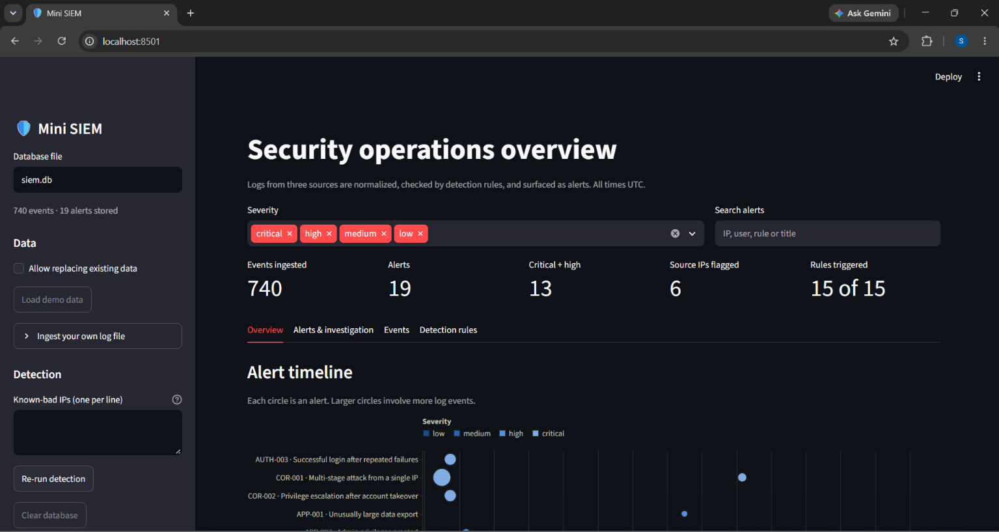
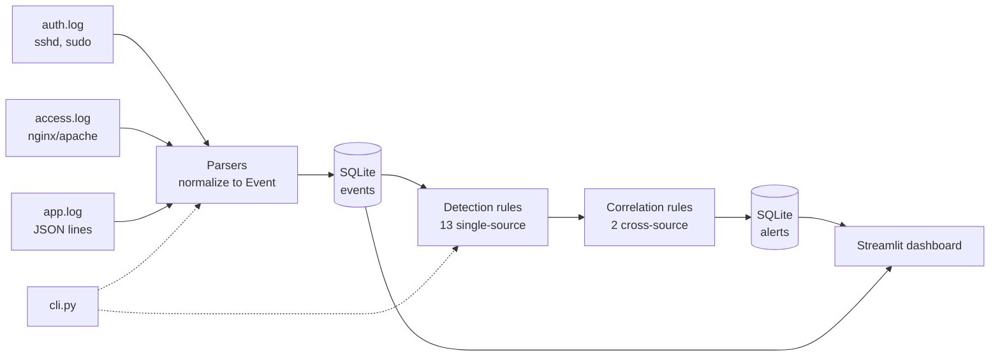

# Mini-SIEM

A small, readable **Security Information & Event Management** pipeline in Python. It collects logs from three different sources, normalizes them into one schema, runs **15 detection rules** (mapped to MITRE ATT&CK, including cross-source correlation), stores everything in SQLite, and presents alerts in a Streamlit analyst dashboard with an investigation view.

It mirrors the core loop of a real SOC: **collect -> normalize -> detect -> triage -> investigate.**



## Features

- **Three log sources, one schema**: Linux `auth.log` (sshd + sudo), Apache/nginx combined access logs, JSON-lines application logs. Adding a source means writing one parser function.
- **15 detection rules**: brute force, password spraying, account takeover, SQL injection, XSS, path traversal, command injection, scanner tools, directory enumeration, suspicious sudo, bulk data export, off-hours admin grant, threat-intel blocklist, plus two **correlation rules** that combine alerts across sources.
- **Idempotent**: re-ingesting a file or re-running detection never creates duplicates, while genuinely repeated log lines are still preserved.
- **Analyst dashboard**: KPIs, alert timeline, event volume by source, severity breakdown, top offending IPs, MITRE ATT&CK coverage, a searchable alert table, and an investigation panel showing the raw evidence lines and everything else that IP or user did.
- **Demo data generator**: a day of realistic benign traffic plus six injected attack scenarios, using only RFC 5737 documentation IPs (`203.0.113.x`, `198.51.100.x`, `192.0.2.x`).
- **53 automated tests**, including boundary tests for every rule, an end-to-end pipeline test, and a **false-positive guard** asserting a normal day of traffic raises zero alerts.

## Architecture



| Module | Responsibility |
|---|---|
| `siem/models.py` | `Event` and `Alert` dataclasses: the normalized schema everything speaks |
| `siem/parsers.py` | One parser per log format; returns `None` for lines it does not understand |
| `siem/storage.py` | SQLite persistence with de-duplication |
| `siem/rules.py` | All detection and correlation rules plus thresholds (`DEFAULT_CONFIG`) |
| `siem/engine.py` | `ingest_file()` and `detect()`: the glue |
| `siem/sample_data.py` | Synthetic log generator with attack scenarios |
| `cli.py` | Command-line interface |
| `dashboard.py` | Streamlit dashboard |

## Quick start

```bash
python -m venv .venv && source .venv/bin/activate      # Windows: .venv\Scripts\activate
pip install -r requirements.txt

python cli.py demo            # generates sample logs, ingests them, runs detection, prints alerts
streamlit run dashboard.py    # open http://localhost:8501
```


Run the tests: `python -m pytest`

### Using your own logs

```bash
python cli.py ingest --source auth --file /var/log/auth.log --year 2026
python cli.py ingest --source web  --file /var/log/nginx/access.log
python cli.py ingest --source app  --file app.log
python cli.py detect --blocklist my_blocklist.txt
python cli.py alerts --min-severity high
```

You can also upload files from the dashboard sidebar. Only analyze logs from systems you own or are authorized to monitor.

## Detection rules

| ID | Detection | Severity | MITRE ATT&CK |
|---|---|---|---|
| AUTH-001 | Brute-force login attempt | high | T1110.001 |
| AUTH-002 | Password spraying | high | T1110.003 |
| AUTH-003 | Successful login after repeated failures | critical | T1078 |
| WEB-001 | SQL injection attempt | high | T1190 |
| WEB-002 | Cross-site scripting (XSS) attempt | medium | T1190 |
| WEB-003 | Path traversal / local file inclusion | high | T1190 |
| WEB-004 | OS command injection attempt | high | T1059 |
| WEB-005 | Known attack/scanner tool detected | medium | T1595.002 |
| WEB-006 | Directory / file enumeration (404 burst) | medium | T1595.003 |
| SYS-001 | Suspicious privileged command (sudo) | medium | T1548.003 |
| APP-001 | Unusually large data export | high | T1213 |
| APP-002 | Admin privileges granted (high when off-hours) | medium / high | T1098 |
| TI-001 | Traffic from known-bad IP (threat intel) | high | n/a |
| COR-001 | Multi-stage attack from a single IP | critical | TA0001, TA0006 |
| COR-002 | Privilege escalation after account takeover | critical | T1078, T1548.003 |

Design points worth knowing:

- **Bursts, not sliding windows.** A long attack produces *one* alert, not hundreds. A burst keeps growing while consecutive events stay within the window.
- **Brute force vs. spraying are mutually exclusive.** Many failures against few accounts is brute force; many accounts is spraying. The same attempts are not reported twice.
- **Correlation raises confidence.** COR-001 fires when one IP triggers both web-attack and authentication alerts (recon followed by credential attack). COR-002 fires when a taken-over account runs suspicious `sudo` commands within an hour.
- **Double-decoded URLs.** Web payloads are URL-decoded twice so `%2527`-style evasion is still caught.

## Adding your own rule

A rule is one function. Register it and it runs, appears on the dashboard's rules tab, and is counted in the KPIs:

```python
# siem/rules.py
@rule("AUTH-004", "Login from a new country", "medium", "T1078", "Account used from an unusual location.")
def new_country(r, events, cfg):
    out = []
    for e in events:
        if e.event_type == "auth_success" and e.extra.get("country") not in cfg["home_countries"]:
            out.append(_alert(r, [e], f"{e.username} logged in from {e.extra.get('country')}.",
                              ip=e.src_ip, user=e.username))
    return out
```

Then add a test in `tests/test_rules.py` (copy the pattern: build a few `Event`s, call `run_detection`, assert on `rule_id`). For simple regex matching on web requests, call `_pattern_rule(...)` instead; see WEB-001.

## Adding a log source

Write `parse_xxx_line(line) -> Optional[Event]` in `siem/parsers.py`, add it to `PARSERS`, and every rule that keys off `event_type` (`auth_failure`, `auth_success`, ...) works on it immediately. That is the payoff of normalization.

## Limitations (and what I would do next)

Being honest about these is part of the project:

- **Batch, not streaming.** Detection re-reads stored events each run. A production system would tail logs and evaluate rules incrementally.
- **SQLite is fine for demos, not for volume.** The `Storage` class is the seam for swapping in Elasticsearch/OpenSearch or Postgres.
- **Regex rules can be evaded.** Attackers obfuscate. Real deployments layer these with anomaly detection and WAF data. Thresholds were tuned against the synthetic data and would need tuning on real traffic.
- **Syslog has no year**, so the `--year` flag exists (and rolls back a year for December lines read in January).
- **UTC only.** Timestamps are normalized to UTC on ingest.
- **No dashboard authentication.** Do not expose it to the internet as-is.

Ideas for extending it: GeoIP/ASN enrichment, Sigma rule import, alert notifications (email/Slack/webhook), Elasticsearch backend, per-user behavioural baselines, an ML anomaly detector as one more rule.

## Resume bullets

Use only numbers you can defend in an interview, and keep them true as you change the project. These match the project as delivered:

- Built a mini **SIEM** in Python (Streamlit, SQLite) that normalizes **SSH/auth, web-server and JSON application logs** into a common schema and applies **15 detection rules mapped to MITRE ATT&CK**.
- Implemented **cross-source correlation** (web attack + credential attack from one IP; account takeover followed by `sudo` abuse) that escalates to critical multi-stage alerts.
- Designed **idempotent ingestion and alerting** (stable event hashes, alert dedup keys) so re-running pipelines never duplicates data.
- Wrote **53 automated tests**, including per-rule threshold-boundary tests, an end-to-end pipeline test, and a false-positive guard asserting zero alerts on benign traffic.
- Built an analyst dashboard with an alert timeline, severity and top-IP breakdowns, and an investigation view that surfaces raw log evidence.

If you extend the project, you can add measured claims, for example detection results against a public dataset such as CICIDS2017. Measure first, then write the number.

## Interview talking points

- *Why bursts instead of sliding windows?* Alert fatigue: one attack should be one alert.
- *How do you avoid double-counting?* sshd logs both "Invalid user" and "Failed password" per attempt; only the latter counts as a failure. Brute force and spraying are mutually exclusive by distinct-username count.
- *How do you know it doesn't cry wolf?* The benign-day test asserts zero alerts; every rule has just-under and just-over threshold tests.
- *What would break at scale?* Batch detection and SQLite; the storage layer is the seam to replace.

## License

No license file is included yet. Add one before publishing (MIT is a common choice for portfolio projects). The synthetic data uses reserved documentation IP ranges and contains no real hosts or credentials.
